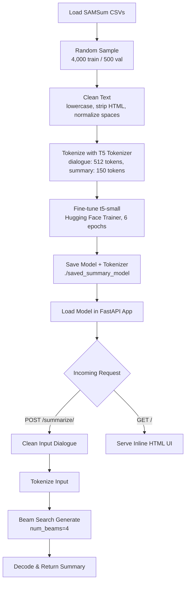

# 📝 Dialogue Summarizer — T5 Fine-Tuning

> An abstractive text summarization tool that fine-tunes a **T5-small** model on the **SAMSum** dialogue dataset, wrapped in a single-file FastAPI app with a built-in web UI. 🚀

---

## 📌 Overview

| | |
|---|---|
|  **Task** | Abstractive dialogue summarization (chat/conversation → short summary) |
|  **Base model** | `t5-small` (Hugging Face Transformers) |
|  **Dataset** | [SAMSum](https://huggingface.co/datasets/samsum) — 4,000 sampled training dialogues, 500 validation dialogues |
|  **Decoding** | Beam search (`num_beams=4`) |
|  **Serving** | Single-file FastAPI app (`app_single_file.py`) — backend + HTML/JS UI in one file, no templates folder needed |
|  **Language** | Python |

---

## ✨ Features

-  Custom text-cleaning pipeline (whitespace normalization, HTML tag stripping, lowercasing)
-  T5 tokenizer with padding/truncation (512 tokens in, 150 tokens out)
-  Fine-tuning via Hugging Face `Trainer` (6 epochs, batch size 8, warmup steps)
-  Beam search decoding for higher-quality summaries
-  REST API (`POST /summarize/`) for real-time summarization
-  Minimal built-in web UI — paste text, click summarize, done
-  Single-file deployment — one Python file runs the whole app

---

## 🔄 How It Works — Pipeline Flowchart



---

## 🗂️ Repo Structure

```
.
├── text_summarizer.ipynb    #  Main notebook: data prep, fine-tuning, inference
├── app.py                   #  Single-file FastAPI app (backend + HTML front end)
├── requirements.txt         #  Python dependencies
├── .gitignore                #  Ignored files (data, model weights, caches)
└── README.md                 #  You are here
```

---

## 🛠️ Setup

```bash
# 1️ Clone the repo
git clone https://github.com/kalyanitangade4/text-summarizer.git
cd text-summarizer

# 2️ Create a virtual environment
python -m venv venv
source venv/bin/activate   # Windows: venv\Scripts\activate

# 3️ Install dependencies
pip install -r requirements.txt
```

---

## 📚 Data

Download the SAMSum dataset (`samsum-train.csv`, `samsum-validation.csv`) from [Hugging Face Datasets — samsum](https://huggingface.co/datasets/samsum) and place them in the project root. Update the paths in the notebook if you store them elsewhere.

---

##  Training

Open and run `text_summarizer.ipynb` end-to-end. This will:

1.  Clean and tokenize the data
2.  Fine-tune `t5-small` for 6 epochs
3.  Save the fine-tuned model + tokenizer to `./saved_summary_model`

> ⏱️ Training time depends on your hardware (CPU / GPU / Apple MPS). A GPU is strongly recommended.

---

## 🚀 Running the App

Once a model is saved to `./saved_summary_model`:

```bash
uvicorn app_single_file:app --reload
```

Then either:

-  Open **http://127.0.0.1:8000** in your browser to use the web UI, or
-  Hit the API directly:

```bash
curl -X POST http://127.0.0.1:8000/summarize/ \
  -H "Content-Type: application/json" \
  -d '{"dialogue": "Alice: Are we still on for lunch? Bob: Yes, 1pm at the usual place."}'
```

**Response:**
```json
{
  "summary": "alice and bob are meeting for lunch at 1pm."
}
```

---

## ⚠️ Notes & Limitations

-  This is a **small-scale fine-tune** (`t5-small`, subsampled data) built as a learning/portfolio project — not a production-grade summarizer.
-  For stronger results, swap in `t5-base` or `t5-large` and use the full SAMSum dataset (given enough compute).
-  `./saved_summary_model` is gitignored — model weights are too large to push to GitHub directly. Anyone cloning this repo needs to run the notebook first to generate it before `app_single_file.py` will work.

---

## 🙋 Author

**Kalyani Tangade**
📧 kalyanitangade4@gmail.com
🐙 [github.com/kalyanitangade4](https://github.com/kalyanitangade4)
